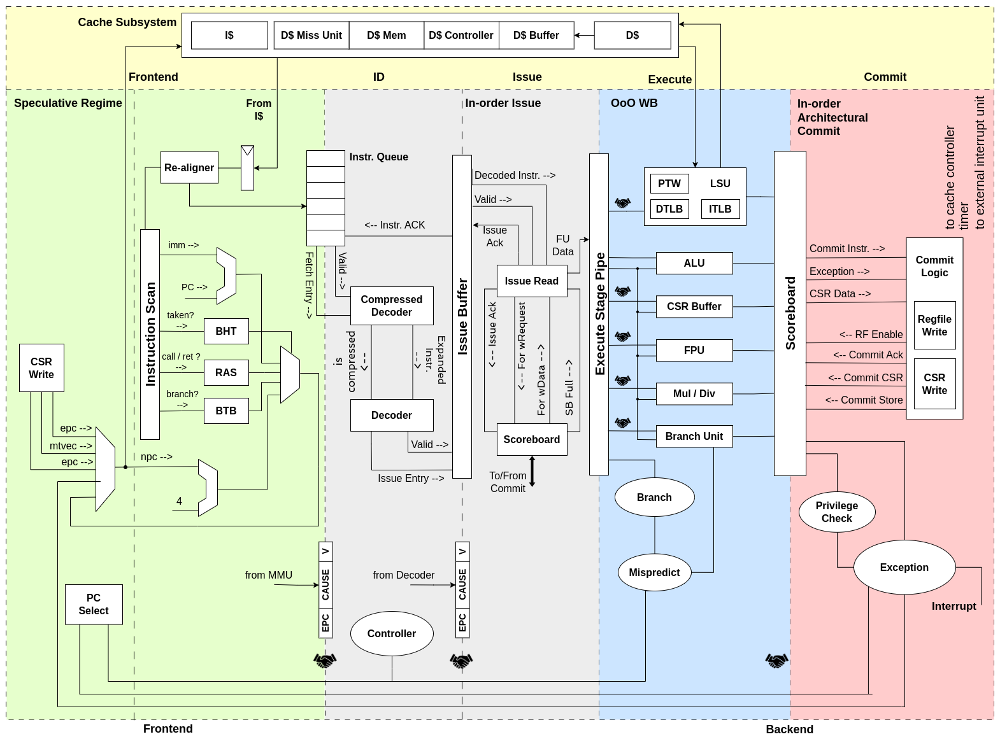

# CVA6 RISC-V CPU [](https://github.com/openhwgroup/cva6/actions/workflows/ci.yml) [](https://riscv-ci.pages.thales-invia.fr/cva6-dashboard/latest/) [](https://docs.openhwgroup.org/projects/cva6-user-manual/?badge=latest) [](https://github.com/openhwgroup/cva6/releases/)

CVA6 is a 6-stage, single-issue, in-order CPU which implements the 64-bit RISC-V instruction set. It fully implements I, M, A and C extensions as specified in Volume I: User-Level ISA V 2.3 as well as the draft privilege extension 1.10. It implements three privilege levels M, S, U to fully support a Unix-like operating system. Furthermore, it is compliant to the draft external debug spec 0.13.

It has a configurable size, separate TLBs, a hardware PTW and branch-prediction (branch target buffer and branch history table). The primary design goal was on reducing critical path length.



# CVA6 Target Configurations

CVA6 supports multiple processor variants (targets), each defining a specific configuration with ISA extensions, memory maps, and RTL parameters. Each target is located in `config/target/<target_name>/` and contains configuration files for compilation, simulation, and verification.

For detailed information on available targets, configuration file formats, and how to create new targets, see [config/README.md](config/README.md).

# Quick Start

#### cook.py

`cook.py` is a Python-based command runner that provides a unified interface for CVA6 workflows including software compilation, RTL simulation with multiple simulators (VCS, Xcelium, Questa), synthesis, and analysis.

**Quick Start Example:**
```bash
# Clone the repository
git clone https://github.com/openhwgroup/cva6.git
cd cva6

# Install Python dependencies (use pip3 if pip is not available)
pip3 install --user -r flows/requirements.txt
# Note: --user installs packages to ~/.local/lib/python*/site-packages
# Ensure ~/.local/bin is in your PATH for black and pylint commands
# Or, to keep them out of the home directory, in a virtual environment:
#   python3 -m venv .venv && . .venv/bin/activate
#   pip3 install -r flows/requirements.txt

# Initialize submodules
git submodule update --init --recursive

# Patch the submodules and clone the external test suites (riscv-tests, ...).
# Required: cook.py stops while a submodule patch of
# flows/config/dependencies.yml is not applied. Run it again after a pull.
./cook.py git-dependencies

# Install Spike ISA simulator (requires: gcc, g++, device-tree-compiler, libboost-dev)
# See verif/regress/install-spike.sh for details
(cd verif/regress && source ./install-spike.sh)

# Configure your environment (adapt to your setup)
# Edit flows/config/setenv.sh - Set paths to your CAD tools (VCS, Xcelium, Questa, etc.)
# Edit flows/config/compiler.yml - Set your RISC-V toolchain paths (GCC or LLVM)
# Edit flows/config/techno.yml - Set your ASIC library paths (optional, for synthesis)
source flows/config/setenv.sh

# Optional: Verify your setup
./cook.py self-check
# Optional: Enable shell autocompletion for cook.py commands
./cook.py --install-completion
# Optional: Get help on available commands
./cook.py --help

# Compile a test program
./cook.py hello-world --target cv32a60x --compiler llvm-20-1-8

# Compile RTL and run simulation with VCS
./cook.py vcs-uvm-comp --target cv32a60x          #
./cook.py vcs-uvm-run --target cv32a60x --testname hello-world

# Or with Xcelium
./cook.py xcelium-uvm-comp --target cv32a60x
./cook.py xcelium-uvm-run --target cv32a60x --testname hello-world

# Or with Questa
./cook.py questa-uvm-comp --target cv32a60x
./cook.py questa-uvm-run --target cv32a60x --testname hello-world
```

**For complete documentation**, see [flows/README.md](flows/README.md)

# Old Quick setup

The following instructions will allow you to compile and run a Verilator model of the CVA6 APU (which instantiates the CVA6 core) within the CVA6 APU testbench (corev_apu/tb).

Throughout all build and simulations scripts executions, you can use the environment variable `NUM_JOBS` to set the number of concurrent jobs launched by `make`:
- if left undefined, `NUM_JOBS` will default to 1, resulting in a sequential execution
of `make` jobs;
- when setting `NUM_JOBS` to an explicit value, it is recommended not to exceed 2/3 of
the total number of virtual cores available on your system.

1. Checkout the repository and initialize all submodules.
```sh
git clone https://github.com/openhwgroup/cva6.git
cd cva6
git submodule update --init --recursive
```
Then apply the submodule patches of `flows/config/dependencies.yml`, without
which the design does not build: `./cook.py git-dependencies` (Python
dependencies in `flows/requirements.txt`).

2. Install the GCC Toolchain [build prerequisites](util/toolchain-builder/README.md#Prerequisites) then [the toolchain itself](util/toolchain-builder/README.md#Getting-started).

:warning: It is **strongly recommended** to use the toolchain built with the provided scripts.

3. Install `cmake`, version 3.14 or higher.

4. Set the RISCV environment variable.
```sh
export RISCV=/path/to/toolchain/installation/directory
```

5. Install `help2man` and `device-tree-compiler` packages.

For Debian-based Linux distributions, run :

```sh
sudo apt-get install help2man device-tree-compiler
```

6. Install the riscv-dv requirements:

```sh
pip3 install -r verif/sim/dv/requirements.txt
```

7. Run these commands to install a custom Spike and Verilator (i.e. these versions must be used to simulate the CVA6) and [these](tutorials/running_sim.md#running-regression-tests-simulations) tests suites.
```sh
# DV_SIMULATORS is detailed in the next section
export DV_SIMULATORS=veri-testharness,spike
bash verif/regress/smoke-tests.sh
```

# Tutorials

* **[Running Simulations](tutorials/running_sim.md)**
* **[ASIC Implementation](tutorials/asic.md)**
* **[FPGA Implementation and running an OS](tutorials/fpga.md)**
* **[Instruction Tracing](corev_apu/instr_tracing/README.md)**

# Directory Structure:

The directory structure separates the [CVA6 RISC-V CPU](#cva6-risc-v-cpu) core from the [CORE-V-APU FPGA Emulation Platform](tutorials/fpga.md#corev-apu-fpga-emulation).
Files, directories and submodules under `cva6` are for the core _only_ and should not have any dependencies on the APU.
Files, directories and submodules under `corev_apu` are for the FPGA Emulation platform.
The CVA6 core can be compiled stand-alone, and obviously the APU is dependent on the core.

The top-level directories of this repo:
* **ci**: Scriptware for CI.
* **common**: Source code used by both the CVA6 Core and the COREV APU. Subdirectories from here are `local` for common files that are hosted in this repo and `submodules` that are hosted in other repos.
* **core**: Source code for the CVA6 Core only. There should be no sources in this directory used to build anything other than the CVA6 core.
* **corev_apu**: Source code for the CVA6 APU, exclusive of the CVA6 core. There should be no sources in this directory used to build the CVA6 core.
* **docs**: Documentation.
* **pd**: Example and CI scripts to synthesis CVA6.
* **util**: General utility scriptware.
* **vendor**: Third-party IP maintained outside the repository.
* **verif**: Verification environment for the CVA6. The verification files shared with other cores are in the [core-v-verif](https://github.com/openhwgroup/core-v-verif) repository on GitHub. core-v-verif is defined as a cva6 submodule.


## verif Directories

- **bsp**:     board support package for test-programs compiled/assembled/linked for the CVA6.
This BSP is used by both `core` testbench and `uvmt_cva6` UVM verification environment.
- **regress**: scripts to install tools, test suites, CVA6 code and to execute tests
- **sim**:     simulation environment (e.g. riscv-dv)
- **tb**:      testbench module instancing the core
- **tests**:   source of test cases and test lists

# Planned Improvements

Go to the CVA6 Kanban Board which also loosely tracks planned improvements.


# Contributing

We highly appreciate community contributions.
<br><br>To ease the work of reviewing contributions, please review [CONTRIBUTING](CONTRIBUTING.md).


# Issues and Troubleshooting

If you find any problems or issues with CVA6 or the documentation, please check out the [issue tracker](https://github.com/openhwgroup/cva6/issues)
and create a new issue if your problem is not yet tracked.


# Publication

If you use CVA6 in your academic work you can cite us:

<details>
<summary>CVA6 Publication</summary>
<p>
```
@article{zaruba2019cost,
   author={F. {Zaruba} and L. {Benini}},
   journal={IEEE Transactions on Very Large Scale Integration (VLSI) Systems},
   title={The Cost of Application-Class Processing: Energy and Performance Analysis of a Linux-Ready 1.7-GHz 64-Bit RISC-V Core in 22-nm FDSOI Technology},
   year={2019},
   volume={27},
   number={11},
   pages={2629-2640},
   doi={10.1109/TVLSI.2019.2926114},
   ISSN={1557-9999},
   month={Nov},
}
```
</p>
</details>
<br/>


# Resources and Ecosystem

The CVA6 core is part of a vivid ecosystem. In [this document](RESOURCES.md), we gather pointers to this ecosystem (building blocks, designs, partners...)

# Acknowledgements

Check out the [acknowledgements](ACKNOWLEDGEMENTS.md).
